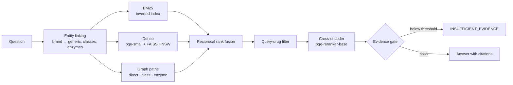

# BioMed Hybrid GraphRAG

Question answering over FDA drug labels that **cites its evidence and refuses when the labels
don't contain an answer**. It combines BM25, dense retrieval and a knowledge graph extracted
from the labels, reranks with a cross-encoder, and gates generation on a calibrated relevance
threshold.

Built from scratch in Python (no LangChain or LlamaIndex), so every stage is visible,
testable and measured.

| | |
| :-- | :-- |
| **Corpus** | 250 FDA prescribing-information labels from openFDA → 6,589 passages |
| **Knowledge graph** | 291 nodes (drugs, drug classes, enzymes), 3,583 edges, each linked to the passages it was extracted from |
| **Retrieval, Hit@3** | **90.5%**, vs. 84.1% for hybrid search + reranker and 69.8% for hybrid search alone |
| **Unanswerable questions refused** | **94.1%**, with 3.2% of answerable questions wrongly refused |
| **Latency** | 132 ms p50 / 138 ms p95 per query on a laptop RTX 3050 Ti |

All figures are from a held-out test split; method and full tables are in
[Evaluation](#evaluation) and [`eval/RESULTS.md`](eval/RESULTS.md).

> Research project. Not medical advice and not for clinical use.

## Why a graph, and why a gate

Two things break a plain "embed, retrieve, generate" pipeline on drug-interaction questions.

**The question and the evidence often share no vocabulary.** Ask *"Can I take Viagra with
Nitrostat?"* and the passage that answers it says *"contraindicated in patients using organic
nitrates"*. It names neither brand, and not even nitroglycerin. Connecting the two takes two
facts: Nitrostat is nitroglycerin, and nitroglycerin is a nitrate. Here that is a graph path:

```
sildenafil ─CONTRAINDICATED_WITH→ nitrates ←MEMBER_OF─ nitroglycerin
clarithromycin ─INHIBITS→ CYP3A4 ←SUBSTRATE_OF─ simvastatin
```

Each edge points at the label passages it was extracted from, so a path is a way of finding
passages, not an answer by itself. On brand-name questions, hybrid search finds the right
passage 33% of the time; with entity linking and the graph it is 92–100%.

**A retriever always returns something.** Ask about a drug that isn't in the corpus and you
still get ten passages, and a language model will write a confident answer from them. The
evidence gate refuses unless the best passage clears a relevance threshold that was
calibrated on held-out data.

## Architecture



| Stage | File | What it does |
| :-- | :-- | :-- |
| Ingestion | [`scripts/ingest_data.py`](scripts/ingest_data.py) | Fetches one prescription label per generic from openFDA and keeps the sections relevant to interactions |
| Chunking | [`core/chunking.py`](core/chunking.py) | Sentence-packed windows that never cross a label section; every passage keeps its drug and section |
| Entity linking | [`core/entities.py`](core/entities.py) | Gazetteer for 251 generics, their brand names, 29 drug classes and CYP/transporter spellings |
| Sparse retrieval | [`core/sparse.py`](core/sparse.py) | BM25 over an inverted index with a tokenizer that keeps `P-gp`, `HMG-CoA` and `50mg` intact |
| Dense retrieval | [`core/dense.py`](core/dense.py) | `bge-small-en-v1.5` embeddings in FAISS HNSW (99.6% of exact top-10) |
| Knowledge graph | [`core/kg_builder.py`](core/kg_builder.py), [`core/graph.py`](core/graph.py) | Sentence-level extraction rules; path search between the entities in the question |
| Fusion | [`core/fusion.py`](core/fusion.py) | Reciprocal rank fusion across the three channels |
| Reranking | [`core/reranker.py`](core/reranker.py) | Cross-encoder logits over the top 20 fused candidates (fp16 on GPU) |
| Evidence gate | [`core/gate.py`](core/gate.py) | Calibrated threshold on the best logit, plus a check for drug names absent from the corpus |
| Generation | [`core/generator.py`](core/generator.py) | Extractive by default (quotes label sentences, runs offline); Gemini or OpenAI-compatible if a key is set |
| Orchestration | [`core/pipeline.py`](core/pipeline.py) | One `retrieve()` with every stage switchable, used by both the API and the evaluation |

## Evaluation

149 questions written for this corpus: 95 answerable in five categories and 54 unanswerable
in four. A third of each category is a **dev** split, used to calibrate the gate threshold
and to debug. The rest is the **test** split (63 answerable, 34 unanswerable), and every
number below comes from it. Intervals are 95% bootstrap intervals.

Gold evidence is defined by rules rather than by what a retriever returned: a passage is
relevant if it comes from a named drug's label and contains one of a set of terms
(see [`eval/build_dataset.py`](eval/build_dataset.py)).

### Retrieval ablation

| Configuration | Hit@1 | Hit@3 | 95% CI | MRR@10 | p95 latency |
| :-- | --: | --: | :-: | --: | --: |
| BM25 | 52.4% | 66.7% | 54–78% | 0.603 | 3 ms |
| Dense (bge-small, HNSW) | 54.0% | 68.3% | 56–79% | 0.620 | 14 ms |
| Hybrid (BM25 + dense, RRF) | 58.7% | 69.8% | 57–81% | 0.663 | 16 ms |
| Hybrid + cross-encoder | 68.3% | 84.1% | 75–92% | 0.761 | 136 ms |
| Hybrid + entity linking + graph | 74.6% | 88.9% | 81–95% | 0.826 | 16 ms |
| **Full pipeline** | **77.8%** | **90.5%** | 83–97% | **0.839** | 138 ms |

Against the strongest standard baseline (hybrid + cross-encoder), the full pipeline finds
evidence for 4 test questions the baseline misses and loses none (paired difference in
Hit@3: +2 to +13 points).

Hit@3 by question type:

| Configuration | direct | brand names | drug class | mechanism | single drug |
| :-- | --: | --: | --: | --: | --: |
| Hybrid (BM25 + dense, RRF) | 89.5% | 33.3% | 66.7% | 75.0% | 75.0% |
| Hybrid + cross-encoder | 94.7% | 66.7% | 75.0% | 100.0% | 75.0% |
| Full pipeline | 100.0% | 91.7% | 75.0% | 100.0% | 75.0% |

What the ablation shows:

- **Entity linking and the graph are worth more than the reranker, at a tenth of the cost.**
  Without any cross-encoder they reach 88.9% Hit@3 in 16 ms; the reranker alone reaches
  84.1% in 136 ms. If latency mattered more than the last 1.6 points, the reranker could be
  dropped from retrieval. It stays because the gate needs its scores.
- **The gain is concentrated where it should be.** Brand-name questions go from 33% to 92%.
  Direct questions that name both generics were already at 90% with plain hybrid search.
- **Drug-class questions did not improve** (75% in every reranked configuration), and
  single-drug questions are no better than plain hybrid search. These are the weakest areas.

### Evidence gate

The threshold (τ = 0.23 on the cross-encoder logit) was chosen on the dev split by maximising
balanced accuracy, then applied unchanged to the test split.

| Gate | Unanswerable refused | 95% CI | Answerable wrongly refused | 95% CI |
| :-- | --: | :-: | --: | :-: |
| Relevance threshold only | 94.1% | 85–100% | 3.2% | 0–8% |
| Vocabulary check only | 44.1% | 29–62% | 0.0% | 0–0% |
| **Combined (shipped)** | **94.1%** | 85–100% | **3.2%** | 0–8% |

| Kind of unanswerable question | Refused |
| :-- | --: |
| Invented drug names | 100% |
| Real drugs that are not in the corpus | 100% |
| Off-topic | 100% |
| Corpus drugs, but the labels don't contain the answer | 84.6% |

The max reranker logit separates answerable from unanswerable questions with AUROC 0.984.

Two results here are less flattering and worth stating:

- **The vocabulary check adds no refusals on the test split**; the relevance threshold
  already catches everything it catches. It is kept because it costs nothing, never caused a
  false refusal, and lets the refusal say *which* term was not found.
- **The hard case is two real drugs with no documented interaction.** Both misses are of this
  kind (famotidine + finasteride, nitrofurantoin + montelukast): each drug has relevant-looking
  interaction passages, just not about the other drug.

### End to end

Of the 63 answerable test questions, 87.3% were answered with a gold passage among the cited
ones, 9.5% were answered with passages outside the gold set, and 3.2% were wrongly refused.

### Reproducing

```bash
python eval/run_evaluation.py     # about two minutes on a GPU; rewrites eval/RESULTS.md
```

## Limitations

- **Small evaluation set.** 97 test questions give wide intervals (Hit@3: 83–97%). The
  ranking of configurations is clear; the exact figures are not precise.
- **I wrote the questions and the gold rules.** Gold relevance is rule-based (label + term
  match), not judged by a pharmacist, and uses lexical matching, which if anything favours
  BM25.
- **Answer quality is not measured.** The evaluation covers retrieval and refusal. With the
  default extractive generator an answer is quoted label text, so it cannot be unfaithful,
  but it is also not a synthesis. LLM answers are supported but were not evaluated.
- **Relation extraction is rule-based** and tuned for precision. Inhibitor/inducer edges need
  support from at least two passages, which drops some true ones. All 60 are listed in
  [`eval/RESULTS.md`](eval/RESULTS.md) for inspection; precision was not formally measured.
- **One label per drug**, 250 drugs, US labels only. Drug classes and brand names come from a
  hand-maintained lexicon ([`core/lexicon.py`](core/lexicon.py)).
- **The reranker is a general-domain model.** Its scores are sensitive to phrasing; a
  domain-tuned cross-encoder would likely widen the gate's margin.

## Quickstart

Requires Python 3.10+. A GPU is optional; on CPU expect roughly a second per query.

```bash
pip install torch --index-url https://download.pytorch.org/whl/cu124   # or .../whl/cpu
pip install -e ".[dev]"

python scripts/build_indexes.py        # chunks, graph and embeddings from data/corpus.jsonl.gz
uvicorn api.routes:app --port 8000     # then open http://localhost:8000
```

The corpus snapshot is in the repository, so nothing needs to be downloaded except the two
models. To rebuild the corpus from openFDA: `python scripts/ingest_data.py --refresh`.

Open `http://localhost:8000` for the demo page. For each question it shows the answer, the
cited passages with links to DailyMed, the entities that were linked, the graph paths that
were found, which channel retrieved each candidate, and where the gate cut off.

```bash
pytest                # 61 tests, under 2 seconds, no models or index needed
ruff check .
```

### API

```bash
curl -s localhost:8000/v1/query -H "Content-Type: application/json" \
     -d '{"query": "Why is clarithromycin contraindicated with Zocor?"}'
```

Actual response, abridged (two more citations, three more graph paths and the candidate
list are omitted):

```jsonc
{
  "answer": "Intervention: Concomitant use of strong CYP3A4 inhibitors with Simvastatin is contraindicated [see CONTRAINDICATIONS ( 4 )] . Examples: Select azole anti-fungals (...), select macrolide antibiotics (...) [1] ...",
  "refused": false,
  "answer_mode": "extractive",
  "gate": { "passed": true, "reason": "ok", "max_score": 4.898, "threshold": 0.23, "unknown_terms": [] },
  "citations": [
    { "n": 1, "chunk_id": "simvastatin::drug_interactions::001",
      "title": "Simvastatin (Zocor)", "section": "DRUG INTERACTIONS", "score": 4.898,
      "retrieved_by": { "graph": 3, "sparse": 1, "dense": 5 },
      "url": "https://dailymed.nlm.nih.gov/dailymed/drugInfo.cfm?setid=0ccb324f-877d-4f32-a769-7cd1637b7fad",
      "text": "Concomitant use of strong CYP3A4 inhibitors with simvastatin increases simvastatin exposure and increases the risk of myopathy and rhabdomyolysis ..." }
  ],
  "entities": [
    { "text": "clarithromycin", "canonical": "clarithromycin", "kind": "DRUG" },
    { "text": "Zocor", "canonical": "simvastatin", "kind": "DRUG" }
  ],
  "graph_paths": [
    { "kind": "direct", "triples": [["clarithromycin", "CONTRAINDICATED_WITH", "simvastatin"]] },
    { "kind": "class",  "triples": [["simvastatin", "CONTRAINDICATED_WITH", "macrolide antibiotics"], ["clarithromycin", "MEMBER_OF", "macrolide antibiotics"]] },
    { "kind": "enzyme", "triples": [["clarithromycin", "INHIBITS", "CYP3A4"], ["simvastatin", "SUBSTRATE_OF", "CYP3A4"]] }
  ],
  "timings_ms": { "graph": 0.3, "sparse": 0.6, "dense": 13.4, "fusion": 0.2, "rerank": 120.7, "generate": 0.7 },
  "latency_ms": 136.1
}
```

A refused question returns `"refused": true`, no citations, and the reason in `gate.reason`
(`low_relevance`, `unknown_term` or `no_candidates`). For example, *"What is the interaction
between Zynorapid and warfarin?"* returns `INSUFFICIENT_EVIDENCE ... Not found in the corpus:
Zynorapid.`

Set `GEMINI_API_KEY` or `OPENAI_API_KEY` (see [`.env.example`](.env.example)) to have an LLM
write the answer from the gated passages instead of quoting them.

## Repository layout

```
api/            FastAPI app, response schemas, demo page
core/           chunking, retrievers, entity linking, graph, fusion, reranker, gate, generator, pipeline
configs/        config.yaml: every tunable in one place
scripts/        ingest_data.py (openFDA → corpus), build_indexes.py (corpus → indexes)
eval/           build_dataset.py, dataset.jsonl, run_evaluation.py, RESULTS.md
tests/          unit tests on in-memory fixtures
data/           corpus.jsonl.gz (versioned snapshot); built indexes are git-ignored
```

## Data and licence

Label text comes from the [openFDA drug label API](https://open.fda.gov/apis/drug/label/) and
is in the public domain. Code is released under the [MIT licence](LICENSE).
